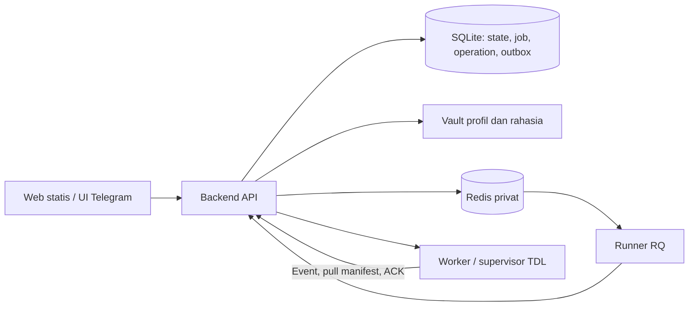

# Catatan implementasi backend, worker, dan Web

## Status paket

Paket ini kini menjadi catatan 13 task yang selesai (P0, P1, dan 01–11). Task 12–22 dibatalkan pada 2026-10-24 dan dokumen task-nya dihapus. Hasil historis ada di [PROGRESS](PROGRESS.md); completed source/fondasi 01–11 tetap dipakai aplikasi.
Task 04–11 sudah menjadi bagian runtime aktif. Menghapus Redis/RQ atau operasi durable secara terpisah akan memutus operasi yang masih dipakai, termasuk penghapusan profil. Tidak ada perubahan runtime itu dalam pembatalan task 12–22.
Rekomendasi dan pertanyaan bersyarat tersisa di [RECOMMENDATIONS](RECOMMENDATIONS.md) dan [OPEN-QUESTIONS](OPEN-QUESTIONS.md); keduanya bukan backlog implementasi aktif.

## Baseline audit — 2026-10-04, Asia/Jakarta

Branch `main`, HEAD `c5c76b3` (sinkron profil); verifikasi ulang dengan git sebelum bekerja.
Worktree sudah berubah pada backend.py, http_client.py, profile_provisioning.py, worker/executor.py, worker/profile_sessions.py, ProfilesPage.svelte, test terkait dan graphify-out/.
Perubahan itu mencakup refresh manual, provisioning, default/adopsi dan lock sesi; jangan dibatalkan atau dianggap sudah deploy.
Tidak ada akses/test production pada penyusunan paket ini. Keadaan deployment terbaru tidak ditemukan/ambigu.

| Area | Fakta source dan bukti |
|---|---|
| Stack/startup | SvelteKit static + FastAPI/Python 3.10; role melalui `tme3bot/app.py`, `composition.py`. `Dockerfile`/`Dockerfile.base`, Compose gateway/worker; tidak ada server Node Web produksi. |
| Backend | `api/backend.py` control plane, `application/control_plane.py` lifecycle, `infrastructure/job_store.py` SQLite, `frontend/client.py` client Telegram. |
| Source | `profiles.py:build_profile_runtime` memilih `state.py:HttpStateStore` pada worker; backend memakai StateStore JSON dengan cache/RLock. Source mengikuti profile, bukan label. |
| Data lama | Layout default /data, profil lain /data/profiles/name; `backup_service.py` masih membawa state lama. File worker bukan otomatis state terbaru. |
| Profil | `profile_provisioning.py` vault AES-GCM + tabel distribusi; `worker/executor.py:sync_profiles` mengirim identity lokal, belum pull revision. |
| TDL/QR | `tdl.py` subprocess/PTY; `worker/profile_sessions.py` menyimpan proses login dalam memori, state() turut membaca PTY/menyelesaikan validasi. |
| Queue | Job persisten tetapi `profile_queue.py` antrean memori; submit ControlPlane masih dispatch. GET login dapat memicu fase validating. |
| Web | Polling di JobTable, QuickModePage, ExportPage, Login; Profiles punya perubahan lokal refresh manual. `web/package.json`: pnpm check/test/build. |
| Settings | `backend_runtime_settings.py` dan `worker/runtime_settings.py` sudah sebagian dinamis; PUT worker masih RPC. `config.py` memerlukan BOT_TOKEN sebelum bootstrap persisten. |
| ENV | Nama dan consumer runtime ada di `config.py`, file `.env.*.example` yang tersedia, dan konfigurasi compose. Tidak ada task inventaris ENV lanjutan yang aktif. |

## Arsitektur target

Backend adalah pemilik state/profile/config. Runner hanya memakai API internal; tidak mount DB/vault.
Worker menyimpan sesi salinan, artifact, journal/outbox dan checkpoint operasional. Channel/last_id hanya di backend.
root/.tdl dan user1/.tdl tetap terpisah; backend tidak menjalankan TDL. Web tidak mengendalikan kelangsungan proses.

## Keputusan dan kontrak bersama

- P0: key Ed25519 laptop disetujui sekali melalui Pengaturan; helper Windows/DPAPI membuat sesi agent tanpa bot, dengan izin actor yang sama.
- Trust perangkat berlaku sampai dicabut; sesi tetap expired/refresh. Revoke memutus semua sesi device; login Telegram dan device tidak saling mengeluarkan.
- Helper/state browser hanya dipakai untuk pekerjaan production yang sudah diotorisasi; tidak ada akses otomatis berdasarkan MAC/IP atau token di URL.

- SQLite backend tetap sumber kebenaran; Redis + RQ untuk orkestrasi singkat. Remote worker tetap HTTP, tanpa Redis.
- Job/operation/plan/outbox harus commit satu transaksi; 202 berarti tersimpan, bukan pekerjaan selesai.
- Pengiriman at least once memakai command_id, attempt, dispatch_token/fencing dan event sequence. Tidak menjanjikan exactly once untuk efek eksternal.
- POST /api/v1/operations memakai allowlist kind, target, input dan Idempotency-Key; GET daftar/status hanya snapshot actor yang berhak.
- DTO publik: operation_id, kind, status, phase, revision, target metadata, progress, job_id opsional, timestamp, error tersanitasi dan status_url. Payload privat tidak dikembalikan.
- Operation status: queued/running/waiting_user/waiting_worker/paused/needs_reconciliation/cancelling/succeeded/failed/cancelled. Dismissed adalah preferensi tampilan.
- Retry tetap operation ID sama dengan attempt baru; job yang sudah ditempatkan tetap pada origin worker. Duplicate submit memakai ID sama.
- Lease hilang heartbeat tidak langsung bebas. Side effect tidak pasti perlu reconciliation; checkpoint aman dapat dilanjutkan.
- Source memakai profile + peer_type/peer_id terverifikasi. Alias belum resolve menunggu; label tidak memisahkan cursor.
- Export profile-channel sama serial lintas worker; baca cursor saat lease diberikan. Start manual tidak menurunkan cursor.
- QuickMode melepas export lane sesudah cursor+artifact commit; fase download/compress/upload tetap memakai limit lama.
- Worker mengambil manifest saat startup dan manual sync; hanya download revisi hilang/berubah. Repair revision sama harus eksplisit.
- Vault tidak otomatis menerima perubahan sesi worker. Upload/login/adopsi/snapshot eksplisit menghasilkan revisi resmi.
- Default ikut vault dan distribusi. Profil baru aktif sesudah semua target awal ACK, termasuk offline/disabled; worker baru menunggu sync lokal.
- TTS tetap dikirim melalui akun TDL profil aktif. Nama legacy TELEGRAM_TTS_CHAT_ID tidak mengembalikan pengiriman Bot API.
- P1 menyediakan diagnosis per helper dan recovery Tor yang dipicu operator dari Workers Web tanpa Docker socket; helper container yang tidak merespons tetap membutuhkan operator host.
- Static Web, auth actor/worker, batas /workspace dan aturan artifact missing tetap dipertahankan.

## Batas rollout

Pekerjaan lintas komponen, canary, dan cutover task 22 dibatalkan bersama task 12–21. Perubahan production tetap mengikuti runbook operator di `AGENTS.md`; dokumen ini tidak memberi instruksi deploy otomatis.

## Urutan task yang sudah selesai

| ID | Task | Prasyarat |
|---|---|---|
| P0 | [Akses production dari laptop tepercaya](00-PRIORITY-trusted-device-access.md) | —; prioritas sebelum 01 |
| 01 | [Repository state backend dan pemisahan runtime profil](01-backend-source-state.md) | — |
| 02 | [Inventarisasi dan migrasi state lama tanpa kehilangan progress](02-legacy-state-migration.md) | 01 |
| 03 | [Operation persisten dan transactional outbox](03-durable-operations-outbox.md) | 01 |
| P1 | [Diagnosis dan pemulihan kesiapan helper TTS](03A-PRIORITY-tts-health-recovery.md) | 03; dikerjakan sebelum 04 |
| 04 | [Redis privat dan proses RQ untuk orkestrasi](04-redis-rq-runtime.md) | 03, P1 |
| 05 | [Penerimaan cepat dan kontrak dispatch berversi](05-background-dispatch-contract.md) | 03, 04 |
| 06 | [Alias peer dan serialisasi export lintas worker](06-shared-export-cursor.md) | 01, 05 |
| 07 | [Vault profil berversi dan kontrak tarik/ACK](07-versioned-profile-vault.md) | 03 |
| 08 | [Konfigurasi terpusat, versi penerapan, dan rahasia](08-desired-runtime-settings.md) | 03, P1 |
| 09 | [Jurnal command worker dan outbox event persisten](09-worker-command-journal.md) | P1, 05 |
| 10 | [Tarik profil saat startup dan sinkronisasi manual](10-worker-profile-pull.md) | 07, 09 |
| 11 | [Executor export memakai cursor bersama dan mengarsip state lokal](11-worker-export-state-cutover.md) | 02, 06, 09, 10 |
